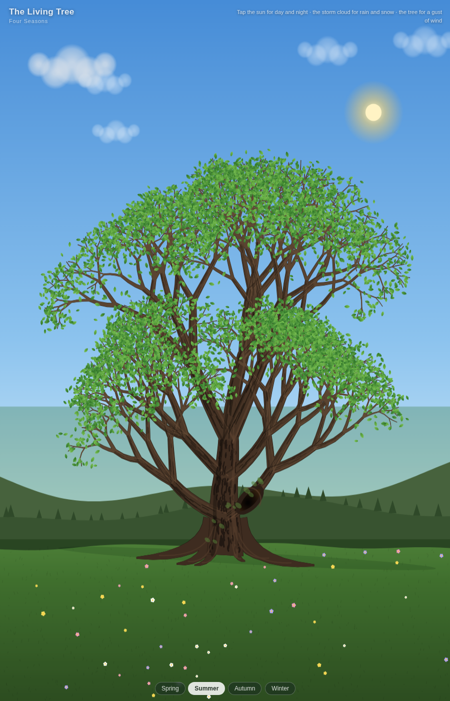
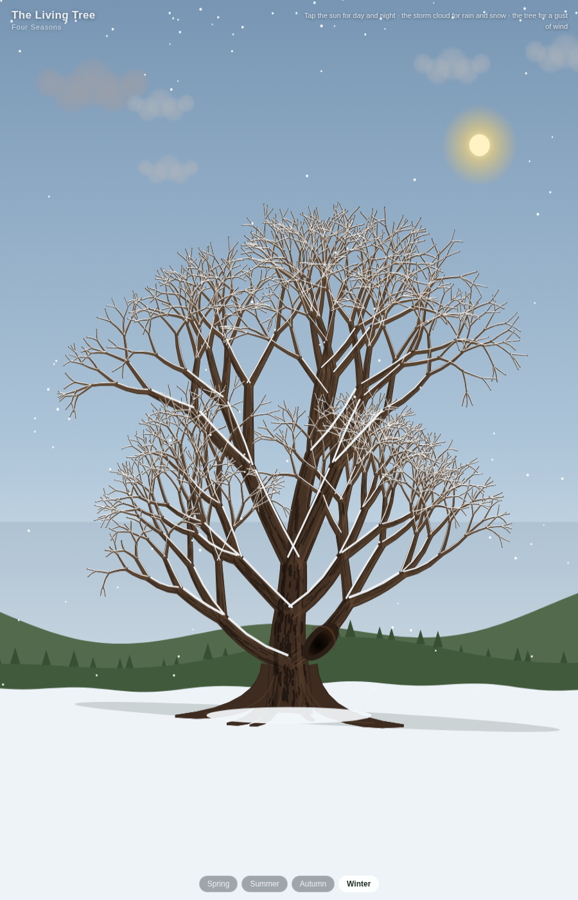

# 🌳 The Living Tree: Four Seasons

An interactive living painting: a hand-coded tree that grows, blooms and sheds its leaves through an endless loop of four seasons — with day and night, rain, thunderstorms, snowfall and gusts of wind. Everything is drawn in code on a `<canvas>`: no libraries, no frameworks, no image assets.




## ▶️ Live demo

- **GitHub Pages:** https://semechkinbo-sketch.github.io/The-Living-Tree-Four-Seasons/
- **SoloLearn:** https://www.sololearn.com/en/compiler-playground/W5nJ86awRhNv

## ✨ Features

- **Four seasons in a loop** — the same tree sprouts fresh green in spring, grows a dense crown in summer, turns yellow and red and drops its leaves in autumn, and sleeps under snow in winter.
- **Day and night** — the sun and moon drift across the sky; tap the sun to switch.
- **Weather** — rain, thunderstorms with lightning, and snowfall that slowly covers the branches and the ground; tap the storm cloud to call it.
- **Wind** — tap the tree for a gust that sways the branches and tears loose leaves away.
- **Always the same tree** — seeded randomness (mulberry32) means every visitor sees the identical tree: 2021 branch segments and 7441 leaves.
- **Mobile-friendly** — touch controls, bounded canvas memory, safe startup inside webviews.

## 🎮 Controls

| Action | Result |
| --- | --- |
| Tap the sun | Switch between day and night |
| Tap the storm cloud | Cycle weather: rain → thunderstorm → snow → clear |
| Tap the tree | A gust of wind |
| Season buttons | Jump to a season; time keeps flowing from there and the year continues with smooth, seamless transitions |

## 🔗 URL parameters

You can deep-link a specific scene:

- `?season=spring|summer|autumn|winter` — starting season
- `?time=day|night` — time of day
- `?weather=rain|snow|storm|clear` — precipitation
- `?speed=2` — animation speed multiplier (default `1`)

Example: `index.html?season=winter&weather=snow&time=night`

## 🚀 Run locally

No build step, no dependencies:

```bash
# just open index.html in a browser, or serve the folder:
python3 -m http.server 8000
# → http://localhost:8000
```

## 📁 Project structure

```
index.html   — page markup: canvas, title, hint, season buttons
style.css    — layout and UI styling
script.js    — the whole living world: tree growth, seasons, sky, weather, particles
```

## 🛠 Built with

Pure HTML, CSS and vanilla JavaScript (Canvas 2D). Written by Semechkin — also on [SoloLearn](https://www.sololearn.com/en/Profile/4509951).
